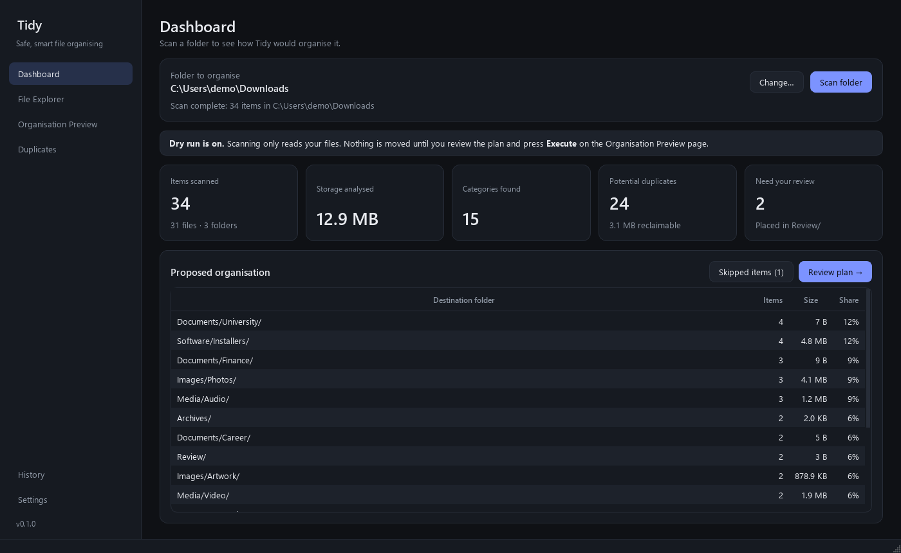
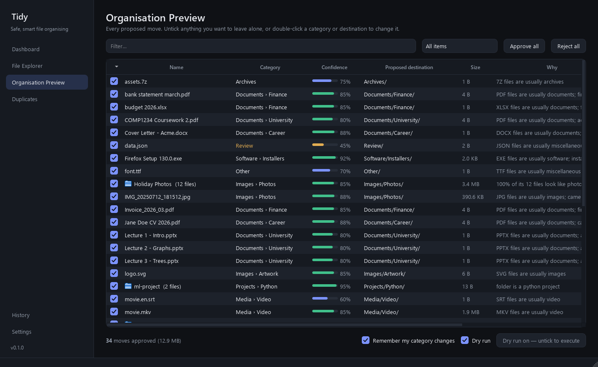
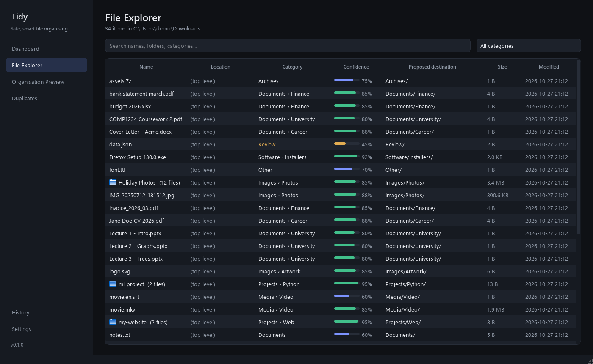
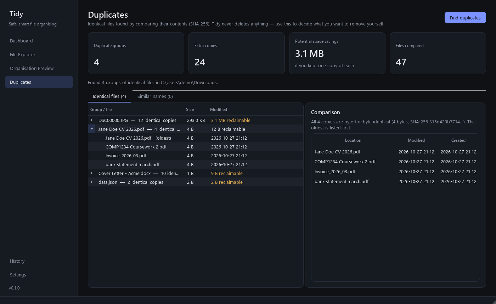

<p align="center">
  
</p>

<h1 align="center">Tidy</h1>

<p align="center">
  <b>An intelligent, safety-first desktop organiser for messy Downloads folders.</b><br>
  Scan → review a plan → approve → organised. Every move is journaled and can be undone.
</p>

<p align="center">
  <a href="https://github.com/ykoch006/tidy/actions/workflows/ci.yml"></a>
  
  
  
</p>

---

| Dashboard | Organisation Preview |
|---|---|
|  |  |
| **File Explorer** | **Duplicates** |
|  |  |

<sub>Screenshots show a synthetic demo folder.</sub>

## Why Tidy?

Most "auto-organisers" move your files first and ask questions never. Tidy does the opposite:

- **Dry run by default.** Scanning only *reads*. You see the full plan — every file, where it
  would go, how confident Tidy is, and *why* — before anything moves.
- **Nothing is ever deleted or overwritten.** Name clashes become `name (1).ext`; duplicates
  are reported, never removed.
- **Undo anything.** Every operation is written to a SQLite journal *before* it runs. Undo
  restores files to where they were, even after a restart — or a crash.
- **Smart, explainable classification.** Rules, local content analysis and (optionally) Claude
  work together, and every decision comes with a human-readable reason.

## Features

| | |
|---|---|
| **Intelligent scanning** | Finds your real Downloads folder (including redirected/OneDrive ones), or any folder you choose. Streams thousands of files on a background thread. Never follows symlinks or junctions; skips system folders, in-progress downloads (`.crdownload`, `.part`) and its own output. |
| **Project-aware** | Recognises Python, web, Rust, Go, Java, .NET, C/C++ and music (Ableton, FL Studio, REAPER…) projects and keeps them whole. Folders are moved as units unless you ask Tidy to look inside. |
| **3-layer classification** | **1. Rules** — extensions plus filename patterns (`Screenshot …`, `IMG_2024…`, `Invoice_…`, course codes like `COMP1234`). **2. Content** — reads the first pages of PDFs, Word/PowerPoint/Excel text, ZIP listings and image EXIF to spot CVs, coursework, invoices, camera photos vs. screenshots, code archives. **3. AI (optional)** — asks Claude about the leftovers, with explicit consent. |
| **Related files stay together** | `report.docx` + `report.pdf`, `movie.mkv` + `movie.en.srt`, `Lecture 1…12.pdf` are grouped. |
| **Learns from you** | Change a category, approve the move, and Tidy remembers a pattern (`invoice_*_*.pdf` → Finance) for next time. Manage learned rules in Settings. |
| **Configurable categories** | Rename destination folders, switch categories off, or add your own — all validated so a typo can never write outside the organised folder. |
| **Exact duplicates** | Size → partial hash → full SHA-256, with a persistent hash cache. Shows potential savings and separates true duplicates from files that merely *look* alike by name. |
| **Polished desktop UI** | PySide6, dark mode by default (light available), responsive background workers, search/filter/sort everywhere. |
| **CLI too** | `tidy-cli plan`, `organise`, `duplicates`, `history`, `undo`. |

### Default layout

```
Downloads/
├── Documents/      University/  Career/  Finance/  Personal/
├── Images/         Screenshots/  Photos/  Artwork/
├── Media/          Audio/  Video/
├── Software/       Installers/
├── Projects/       Python/  Web/  Music/  Code/
├── Archives/
├── Other/
└── Review/         ← anything Tidy isn't confident about
```

## Safety model

Data integrity is the top priority. In short:

1. **Write-ahead journal** — the whole operation is recorded before the first file moves; each
   move is marked *in progress* and *done* durably (SQLite `synchronous=FULL`).
2. **Re-validation at execution time** — each source is re-fingerprinted (size + mtime; for
   folders, a full walk). Anything changed, missing or now a link since the scan is skipped.
3. **Safe destinations** — every target is checked to be inside the organised folder, with no
   link/junction on the way, and never an existing name.
4. **Atomic moves** — same-drive moves are a single no-overwrite rename. Cross-drive moves copy to
   a temporary `.tidy-partial` file, verify SHA-256, atomically rename into place, and only then
   remove the original. Timestamps (including Windows creation time) are preserved.
5. **Crash recovery** — on start-up Tidy inspects any move left *in progress* and either finishes
   it (after verifying the copy) or rolls it back. At most one move per operation is ever
   ambiguous.
6. **Undo** — reverse order, never overwriting; restored items go beside anything new that has
   taken their place. Only *empty* folders Tidy created are removed.

See [docs/ARCHITECTURE.md](docs/ARCHITECTURE.md) for details.

## Installation

### Windows executable

Download `Tidy-windows` from the [Actions artifacts / Releases](https://github.com/ykoch006/tidy/actions)
and run `Tidy.exe`, or build it yourself (see [Packaging](#packaging-a-windows-executable)).

### From source

Requires **Python 3.12+**.

```bash
git clone https://github.com/ykoch006/tidy.git
cd tidy
python -m venv .venv
.venv\Scripts\activate            # Windows  (source .venv/bin/activate on Linux/macOS)
pip install -e ".[ai]"             # drop [ai] if you don't want Claude support
```

For the exact, tested dependency versions:

```bash
pip install -r requirements-lock.txt -e .
```

## Usage

### Desktop app

```bash
tidy            # or: python -m tidy
```

1. **Dashboard** — check the folder (your Downloads folder by default) and press **Scan folder**.
2. **Organisation Preview** — review the plan. Untick anything you want left alone, double-click
   a category or destination to change it, filter by *Needs review*, *Low confidence*,
   *Has identical copies*…
3. Untick **Dry run**, press **Execute**, and confirm.
4. **History** — see every operation and file, and **Undo** with one click.

> **Tip:** Try it on a copy first. Point Tidy at a test folder via **Change…** on the Dashboard,
> or start it with `TIDY_DOWNLOADS_DIR=C:\path\to\test-folder`.

### Command line

```bash
tidy-cli plan                         # dry-run plan for your Downloads folder
tidy-cli plan D:\Messy --subfolders   # look inside sub-folders too
tidy-cli plan --json > plan.json      # machine-readable
tidy-cli organise D:\Messy            # shows the plan, asks "yes" before moving
tidy-cli duplicates                   # report identical files (never deletes)
tidy-cli history -v                   # past operations and every move
tidy-cli undo 3                       # restore operation #3
```

### Optional AI classification

AI is **off** by default. In **Settings → AI classification**:

1. Tick *Use Claude for low-confidence files* and *Send file names*.
   Text excerpts are a separate, optional permission.
2. Provide an API key (or set `ANTHROPIC_API_KEY`, or sign in with `ant auth login`).
3. Save — Tidy shows exactly what will be sent and asks you to confirm.

What is sent, per uncertain item: the file name (never its folder or path), extension, an
approximate size, Tidy's own guess, and — only if you allow it — up to 1,500 characters of text
extracted locally. Claude can only answer with one of your category keys (enforced by a JSON
schema); it never chooses paths. Answers are cached locally so a file is never sent twice, and a
per-scan limit caps cost. The default model is Claude Opus 5.5 (most accurate); Sonnet 5.5 and
Haiku 5.5 are cheaper choices.

## Packaging a Windows executable

```bash
pip install -e ".[ai,build]"
pyinstaller packaging/tidy.spec --noconfirm
# → dist/Tidy/Tidy.exe  (one-folder build; zip the folder to distribute)
```

CI builds the same artifact on demand (*Actions → CI → Run workflow*) and on tags.

## Development

```bash
pip install -e ".[dev]"
pytest                    # ~200 tests; GUI tests run offscreen
ruff check src tests && ruff format --check src tests
```

All tests use temporary folders; a guard fails any test that points at your real Downloads
folder. See [docs/DEVELOPMENT.md](docs/DEVELOPMENT.md).

## Limitations

- Duplicate detection is **exact** (byte-identical). Visually similar photos or re-encoded media
  are not matched.
- Content analysis covers PDF, DOCX/PPTX/XLSX, plain text, ZIP listings and image metadata.
  Scanned (image-only) PDFs are classified by name only — there is no OCR.
- Moving a folder that contains links/junctions to a *different drive* is refused (same-drive
  moves are fine), because links cannot be copied faithfully.
- Change detection uses size + modification time, not a full hash, to stay fast.
- Windows is the primary platform; Linux and macOS are supported by the engine and CI-tested,
  but the UI has had less real-world use there.
- An API key entered in Settings is stored unencrypted in the local database; prefer the
  `ANTHROPIC_API_KEY` environment variable.

## License

[MIT](LICENSE)
